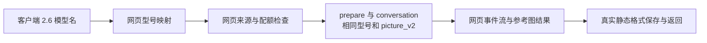

# Image 2.6 网页账号适配计划

> 本文保留用户批准的实施前计划；当前实现与验证记录见 [v0.16.4 网页接入说明](image26-web-integration.zh-CN.md)。下文的基线、拟新增示例与未来验收步骤用于追溯原始要求。

日期：2026-11-12（北京时间）。适用代码基线：`HEAD=5927143`，v0.16.3。本计划依据用户已确认的网页账号通道制定，当前交付是计划文档，下面的业务代码改动尚未执行。

第一期目标是用现有 ChatGPT 网页账号完成 Image 2.6 的文生图、参考图编辑、流式结果与后台任务。关键改动是把具体 2.6 型号传给现有网页会话，选中合法网页来源账号，并正确处理用量、权限、提交恢复和实际图片格式。

## 1. 依据与当前缺口

已经复核 7 个属于真实上游 `basketikun/chatgpt2api` 网络的网页实现。前 6 个在默认分支，gkingt 在非默认 `my_1.5.0` 分支。它们均将 `gpt-image-2.6-sunburst` / `gpt-image-2.6-flare` 保留到 prepare 和 submit 的 `model`，并沿用 `picture_v2`。这是源码中的请求支持，尚不能证明本地每个 Free 或付费网页账号都获得了该型号权限。

| 网页参考实现 | 固定提交 | 主要可借鉴项与源码 |
| --- | --- | --- |
| jiawen-afk/chatgpt2api | `7ab8c2028113` | [精确型号映射](https://github.com/jiawen-afk/chatgpt2api/blob/7ab8c20281133f8e78f54b8c762a604e702abebb/services/openai_backend_api.py#L693-L702)、[旧缓存回归](https://github.com/jiawen-afk/chatgpt2api/blob/7ab8c20281133f8e78f54b8c762a604e702abebb/test/test_multi_image_results.py#L270-L294) |
| mxw13579/chatgpt2api | `d3fa3571eb04` | [同一型号进入网页提交](https://github.com/mxw13579/chatgpt2api/blob/d3fa3571eb045f2f9e83a1a22f755dfe373ea026/services/openai_backend_api.py#L1146-L1156)，与上一项共享部分代码 |
| lc2022560478/chatgpt2api | `17f7ef184980` | [两个变体专门原样映射](https://github.com/lc2022560478/chatgpt2api/blob/17f7ef18498055ebccb280f9ca065be1fce817ed/services/openai_backend_api.py#L624-L645) |
| hp0912/chatgpt2api | `e5bae8714da0` | [网页实际请求断言](https://github.com/hp0912/chatgpt2api/blob/e5bae8714da06c4e3676dd00d04bd56266c35d64/test/test_image_model_routing.py#L35-L64)；[维护者说明尚未实测](https://github.com/hp0912/chatgpt2api/blob/e5bae8714da06c4e3676dd00d04bd56266c35d64/README.md#L129-L130) |
| FatalErrorR/chatgpt2api | `53119b5c4682` | [Web 型号独立解析](https://github.com/FatalErrorR/chatgpt2api/blob/53119b5c4682c5606c9b4c80ad9d76d64105686e/utils/helper.py#L163-L172) |
| IFuZYI/chatgpt2api | `af7bef567604` | [Go 网页实现保留型号](https://github.com/IFuZYI/chatgpt2api/blob/af7bef567604877e0e6d452c64ed4d6ee8208004/internal/upstream/image_chain.go#L28-L60)；维护者有未分套餐的实测声明 |
| gkingt/chatgpt2api · `my_1.5.0` | `8c319b2f2319` | [两次网页请求测试](https://github.com/gkingt/chatgpt2api/blob/8c319b2f2319b5111e03ea6ea33a579d7887b81d/test/test_web_image26.py#L26-L44)、[网页来源隔离](https://github.com/gkingt/chatgpt2api/blob/8c319b2f2319b5111e03ea6ea33a579d7887b81d/services/account_service.py#L256-L262) |

完整证据、67 条已检查文件和行号的固定链接、权限与新能力边界见 [网页通道证据](research/image26-web-channel-evidence.zh-CN.md)。

本地当前的三个缺口已从代码确认：

- [模型注册表](https://github.com/fujunchao/chatgpt2api/blob/5927143ec4421886b5e1f563718b564c0bdf52d9/utils/image_models.py#L11) 没有 2.6，入口目前返回 `400/model_not_found`。
- [网页模型解析](https://github.com/fujunchao/chatgpt2api/blob/5927143ec4421886b5e1f563718b564c0bdf52d9/services/openai_backend_api.py#L561) 对现有 Web 名称都返回 `gpt-5-3`。仅向列表加一个 2.6 名称，会继续发送同一个旧网页请求。
- [选号分流](https://github.com/fujunchao/chatgpt2api/blob/5927143ec4421886b5e1f563718b564c0bdf52d9/services/protocol/conversation.py#L1364) 目前只有裸 `gpt-image-2.5` 被显式绑定 `source_type="web"`。新增 2.6 必须补上这条来源约束。

多数参考 fork 的网页选号用空来源，空来源会匹配全部账号。本地应复用 [现有来源白名单](https://github.com/fujunchao/chatgpt2api/blob/5927143ec4421886b5e1f563718b564c0bdf52d9/services/account_service.py#L150)：`web`、`password`、`oauth_login`，缺省来源按现有规则归 Web；明确排除 `codex` 和未知来源。gkingt 的行为值得参考，其“来源不是 codex”判断也不能直接替换本地更严格的白名单。

## 2. 第一期的模型与请求约定

| 客户端 model | 路由 | 网页 prepare / submit 的 model | 说明 |
| --- | --- | --- | --- |
| `gpt-image-2.6-sunburst` | Web | `gpt-image-2.6-sunburst` | 精确请求 Sunburst |
| `gpt-image-2.6-flare` | Web | `gpt-image-2.6-flare` | 精确请求 Flare |
| `gpt-image-2.6` | Web | `gpt-image-2.6-sunburst` | 建议的本地短名，明确固定为 Sunburst；这不是官网默认行为的声明 |

首次提供三项网页入口。明确的 Flare/Sunburst 不相互改写；若需要改变短名的目标，应作为显式配置变更记录。现有 `gpt-image-2` 和裸 `gpt-image-2.5` 继续使用已建立的网页自动请求；已有 2.5 Codex 名称和历史会话/任务保持各自语义。

关键链路为：



以下是拟新增的映射形态，尚未应用：

```python
# 三个本地入口全部归网页账号通道；短名明确映射到 Sunburst。
WEB_IMAGE_26_UPSTREAM_MODELS = {
    "gpt-image-2.6": "gpt-image-2.6-sunburst",
    "gpt-image-2.6-sunburst": "gpt-image-2.6-sunburst",
    "gpt-image-2.6-flare": "gpt-image-2.6-flare",
}
```

在现有 `WEB_IMAGE_MODELS` / `BASE_IMAGE_MODELS` 中纳入这些网页名称，新增 `is_web_image_26_model` 供选号、目录、用量和参数检查共用。它们不加入 Codex 工具模型表。保留 `is_web_auto_image_model` 和 `is_gpt_image_25_model` 的现有精确含义。

在 `_image_model_slug` 中先解析新映射，再处理旧网页自动入口。现有 [prepare](https://github.com/fujunchao/chatgpt2api/blob/5927143ec4421886b5e1f563718b564c0bdf52d9/services/openai_backend_api.py#L872) 和 [submit](https://github.com/fujunchao/chatgpt2api/blob/5927143ec4421886b5e1f563718b564c0bdf52d9/services/openai_backend_api.py#L977) 已共用该函数，统一修改可以使两次发送保持一致。示意核心顺序为：

```python
# 先保留 2.6 的具体网页型号，不能落入旧模型的默认映射。
if base_model in WEB_IMAGE_26_UPSTREAM_MODELS:
    return WEB_IMAGE_26_UPSTREAM_MODELS[base_model]
if base_model in LEGACY_WEB_IMAGE_MODELS:
    return "gpt-5-3"
```

`LEGACY_WEB_IMAGE_MODELS` 表示现有 `gpt-image-2` 与裸 `gpt-image-2.5`。2.6 的实际发送不以匿名文本模型目录或旧缓存包含该名称为前置条件，也不修改全局普通聊天模型的回退规则。

两次发送分别使用 `/backend-api/f/conversation/prepare` 和 `/backend-api/f/conversation`，将解析后的同一型号放入 `model`。保留顶层以及消息 metadata 内现有的 `system_hints=["picture_v2"]`、网页鉴权与参考图上传构造。

## 3. 按依赖顺序实施

| 阶段 | 工作及文件 | 可验收产物 |
| --- | --- | --- |
| 1：模型和网页请求 | [utils/image_models.py](https://github.com/fujunchao/chatgpt2api/blob/5927143ec4421886b5e1f563718b564c0bdf52d9/utils/image_models.py#L11)、[openai_backend_api.py](https://github.com/fujunchao/chatgpt2api/blob/5927143ec4421886b5e1f563718b564c0bdf52d9/services/openai_backend_api.py#L561)：登记三入口，解析网页型号，两次请求同值 | 请求捕获证明两变体/短名均发送正确 Web 型号；旧模型仍发送原值 |
| 2：网页选号与故障处理 | [conversation.py](https://github.com/fujunchao/chatgpt2api/blob/5927143ec4421886b5e1f563718b564c0bdf52d9/services/protocol/conversation.py#L1364)、[account_service.py](https://github.com/fujunchao/chatgpt2api/blob/5927143ec4421886b5e1f563718b564c0bdf52d9/services/account_service.py#L961)：新入口显式使用网页来源；刷新后复查来源与配额；保留结构化上游错误与提交恢复 | 混合号池不会选到 Codex；额度、权限、认证与断流按实际类别处理 |
| 3：目录、界面、用量和入口校验 | [openai_v1_models.py](https://github.com/fujunchao/chatgpt2api/blob/5927143ec4421886b5e1f563718b564c0bdf52d9/services/protocol/openai_v1_models.py#L11)、[image-models.ts](https://github.com/fujunchao/chatgpt2api/blob/5927143ec4421886b5e1f563718b564c0bdf52d9/web/src/lib/image-models.ts#L1)、[image_tokens.py](https://github.com/fujunchao/chatgpt2api/blob/5927143ec4421886b5e1f563718b564c0bdf52d9/utils/image_tokens.py#L348)、各兼容协议及 [api/image_tasks.py](https://github.com/fujunchao/chatgpt2api/blob/5927143ec4421886b5e1f563718b564c0bdf52d9/api/image_tasks.py#L15) | 目录与界面均标 Web；缺用量标 unavailable；暂未支持的原生参数明确拒绝 |
| 4：图片结果一致性 | [image_storage_service.py](https://github.com/fujunchao/chatgpt2api/blob/5927143ec4421886b5e1f563718b564c0bdf52d9/services/image_storage_service.py#L199)、[image_service.py](https://github.com/fujunchao/chatgpt2api/blob/5927143ec4421886b5e1f563718b564c0bdf52d9/services/image_service.py#L53)：检测真实静态格式并一致保存、响应和下载；复查压缩/清理覆盖 | PNG/JPEG/WebP 原始字节、扩展名与 MIME 一致；非首期格式不被误写成静态 PNG |
| 5：回归与真实网页验收 | 新网页 2.6 测试、已有 Web/OAuth/账号/任务/恢复测试、前端检查；按当前实际网页账号验证 | 两个变体的生成与编辑有记录；权限结果按账号类型区分；通过后发布 |

建议按“请求与选号 → 目录/用量/错误 → 格式与多入口 → 测试/真实验收”拆分小提交，提交说明使用中文。第一期不需要迁移账号来源数据或重写网页登录。

### 网页账号和权限处理

新 2.6 调用使用 `source_type="web"`，因此复用本地对网页 Token、密码登录与内置 OAuth 网页登录的统一匹配。Free、Plus、Team、Pro 等实际存在的网页账号可以按现有健康状态和图片额度进入候选；能入池不代表官网已经接受该具体 2.6 型号。

- 本地初筛和远端刷新后的校验都使用相同来源白名单，额度要求沿用 [现有可用性判断](https://github.com/fujunchao/chatgpt2api/blob/5927143ec4421886b5e1f563718b564c0bdf52d9/services/account_service.py#L132)。
- 新 2.6 没有可用网页账号/额度时返回 `429 insufficient_quota`；不用另一种来源的账号完成它。
- 明确的型号权限拒绝保留上游 status/type/code/param，不把仍能使用旧模型的账号标成认证失效或额度耗尽。
- 只有能够确认未提交的型号权限拒绝，才可对同一型号有限尝试其他网页账号；建议最多 3 个。使用本次请求的排除集合，必要时为 `get_available_access_token` 增加默认空的 `excluded_tokens` 参数，原调用方行为保持兼容。所有尝试都无该型号权限时返回最后的型号错误，不能伪装成一般额度不足。
- 已提交、提交状态未知或已收到结果时沿用既有恢复流程，不通过换号重新生图。保留 [图片 SSE 的 HTTP/1.1](https://github.com/fujunchao/chatgpt2api/blob/5927143ec4421886b5e1f563718b564c0bdf52d9/services/openai_backend_api.py#L1046) 和现有消息 ID 恢复约束。

权限分类以真实网页响应的错误字段为准，不能仅凭 403 数字推断账号失效或模型权限。当前 [token 失效判断](https://github.com/fujunchao/chatgpt2api/blob/5927143ec4421886b5e1f563718b564c0bdf52d9/services/protocol/conversation.py#L76) 已按明确失效文本识别，应保留这一边界。统一图片断流文案，避免网页请求失败时显示硬编码的“Codex 图片请求”。

### 模型目录、界面和多种兼容入口

`GET /v1/models` 的三个新入口由本地网页来源、健康状态和额度判断生成；匿名目录中的同名项先去重，不能让只有 Codex 账号的池展示网页 2.6。目录描述为“网页账号请求该变体，权限以上游为准”，短名明确描述其本地 Sunburst 映射。模型出现在目录不是已认证图片引擎的证明。

图片工作台为三个入口标识 `Web`，复用网页尺寸和 `auto/low/medium/high` 质量选项。尺寸、质量仍通过提示表达，输出以实际图片为准。切换自 Codex 2.5 时，旧 `xhigh/max` 选择按网页规则归一化；不能将 2.6 名称套进 Codex 2.5 的前端判定。

文生图、multipart/JSON 编辑、Chat 图片模式、本项目 Responses 图片工具兼容入口与后台任务都使用同一新模型判定和网页管线。特别是本项目对外的 Responses 入口，即使客户端在 `image_generation` 工具中填 2.6，它的实际上游也仍是本计划的网页会话。后台任务保存请求型号，恢复任务和旧会话时不自动改型号。

各入口在丢弃未知字段之前检查新 2.6 暂不支持的原生参数，避免表面接受却未生效。需要覆盖 [Images 生成](https://github.com/fujunchao/chatgpt2api/blob/5927143ec4421886b5e1f563718b564c0bdf52d9/services/protocol/openai_v1_image_generations.py#L16)、[Images 编辑](https://github.com/fujunchao/chatgpt2api/blob/5927143ec4421886b5e1f563718b564c0bdf52d9/services/protocol/openai_v1_image_edit.py#L1)、[Chat 图片](https://github.com/fujunchao/chatgpt2api/blob/5927143ec4421886b5e1f563718b564c0bdf52d9/services/protocol/openai_v1_chat_complete.py#L233)、[Responses 图片](https://github.com/fujunchao/chatgpt2api/blob/5927143ec4421886b5e1f563718b564c0bdf52d9/services/protocol/openai_v1_response.py#L444) 及任务解析。

### 用量、格式与观测

扩大 [resolve_image_usage](https://github.com/fujunchao/chatgpt2api/blob/5927143ec4421886b5e1f563718b564c0bdf52d9/utils/image_tokens.py#L348) 以及 [ImageOutput 默认来源](https://github.com/fujunchao/chatgpt2api/blob/5927143ec4421886b5e1f563718b564c0bdf52d9/services/protocol/conversation.py#L354) 的适用范围：2.6 Web 没有上游实际 usage 时省略数字用量，返回 `usage_source="unavailable"`。有可确认的上游 usage 则保留；图片 token 不套旧引擎估算公式。

网页请求没有已证实的原生 `output_format` 选择字段。首期验收默认静态 PNG，同时对实际返回的 JPEG/WebP 保留原始字节并使用正确后缀和 MIME（媒体类型）。本地 [make_relative_path](https://github.com/fujunchao/chatgpt2api/blob/5927143ec4421886b5e1f563718b564c0bdf52d9/services/image_storage_service.py#L199) 现在固定 `.png`，远端响应和下载也有 `image/png` 常量，需要一并修正。已有静态扩展名集合可复用；PNG 专用的压缩和按目标空间清理要核对新增静态格式的覆盖。

动画 GIF、SVG 或其它不在首期范围的结果应给出明确格式/能力错误，避免只取首帧或改名为 PNG。校验发生在已生成结果处理阶段，因此格式不匹配不会触发重新提交出图。

增加用于验收的请求型号、解析后网页型号、路由、生成/编辑类别、提交状态、返回格式/实际尺寸和错误类别记录。将请求型号与上游真正声明的引擎身份分开；响应未提供图像引擎身份时保持未知，不从画面、尺寸或请求名推断已认证。

## 4. 参数能力的首期边界

| 能力 | 第一期策略 | 后续开放条件 |
| --- | --- | --- |
| Sunburst / Flare 选择 | 作为两次网页请求的精确 model 发送，短名显式映射 | 本地实际网页账号验证返回结果与模型元数据 |
| 生成、参考图编辑、多图、流式/任务 | 复用现有网页上传、事件流与恢复；纳入回归 | 验证不同协议入口和多参考图 |
| size / quality | 沿用网页提示语义，不声称原生分辨率或质量参数控制 | 取得网页的原生字段与实测证据后再升级语义 |
| GIF、帧数、时长 | 原生参数不开放；不能将提示词动画视为帧参数已接通 | 网页原生选择证据，或另立明确的提示词实验能力；真实多帧、保存与预览验收 |
| SVG、complexity、markup、压缩、部分图像预览 | 参数未获网页证据时明确返回不支持，界面不承诺 | 网页实际请求/响应字段和对应账号权限证据 |
| 文件格式选择 | 首期由网页实际输出决定；保留现有 `response_format=b64_json/url` 返回方式 | 取得网页选择格式的字段后贯通请求与存储 |

公开 Images API 和 Codex 工具中的质量、复杂度、GIF 2–16 帧等规则只属于对应通道，不能作为网页协议的字段定义。网页 width/height 若出现在附件中，是输入参考图的属性，不是输出分辨率参数。

## 5. 测试和放行条件

先加入有意义的请求捕获和 HTTP 回归，再实现上述改动。外部 HTTP、账号刷新、图片下载均用隔离测试替身；测试不接触生产账号。以下是未来实施后的验收，不是当前已有结果：

| 测试层 | 必须证明的行为 |
| --- | --- |
| 名称与映射 | 三入口识别为 Web；Flare/Sunburst 和短名各自正确；大小写/空白规范化；旧 Web 与 Codex 2.5 语义仍正确 |
| 实际网页请求 | prepare 与 submit 都发送同一精确型号和 picture_v2；空/旧匿名目录不改写它；绝不出现新的 Codex 请求地址 |
| 来源与权限 | web/password/oauth_login/缺省 Web 的健康账号可用；codex/未知来源排除；刷新后变更来源再校验；Free 与付费分别作为 fixture（测试数据）验证选号 |
| 目录与界面 | 新条目只由可用网页账号生成；匿名同名项不覆盖本地元数据；三入口标 Web；质量选项与后端一致 |
| 各 HTTP 兼容入口 | Images 生成、multipart/JSON 编辑、Chat、Responses、任务均走网页；模型不变；暂不支持参数在解析丢弃前明确拒绝 |
| 用量与静态格式 | 有真实 usage 保留、无 usage 不估算；PNG/JPEG/WebP 字节、MIME、后缀、下载和缩略图正确 |
| 错误与恢复 | 401/403/429、型号未开放、无图片、已提交断流和未知提交状态分类正确；有限换号不改型号/来源，不重复提交，不误删账号 |

重点复用 [test_free_web_image.py](https://github.com/fujunchao/chatgpt2api/blob/5927143ec4421886b5e1f563718b564c0bdf52d9/test/test_free_web_image.py#L1) 的真实本地 HTTP 入口、账号池和网页请求捕获方式；新增 `test/test_web_image_26.py` 并扩展既有路由、目录、用量、存储、任务与前端测试。回归现有 OAuth 真实入库流程、配额筛选和生产恢复测试，避免仅构造 `source_type=web` 数据而漏掉实际登录来源。

示意执行命令：

```powershell
# 实现后，在隔离副本中运行新模型和已有网页回归。
uv run --no-sync python scripts/run_offline_tests.py test.test_web_image_26 test.test_free_web_image test.test_image_model_routing test.test_account_image_capabilities test.test_multi_image_results test.test_image_tokens test.test_image_storage_service test.test_image_task_service test.test_production_image_recovery test.test_v1_models
bun test ./test/test_image_models_frontend.test.ts
# web 目录中，依赖齐全后再执行完整类型检查和构建。
node ./node_modules/typescript/bin/tsc --noEmit --incremental false
npm run build -- --webpack
```

本轮仅制定计划，尚无新 2.6 测试结果；命令中的新测试文件尚未创建。此前通用调研的 84 项后端/4 项前端基线不是网页 2.6 的真实权限验证。

离线通过后，用当前实际使用的网页账号对两个具体变体分别做一次标准静态生成和参考图编辑；短名验证其 Sunburst 映射。若实际同时使用 Free 和付费网页账号，则分别记录“型号是否被接受、是否出图、返回格式/尺寸、模型身份字段、额度变化、错误类别”。没有相应套餐账号时不声称已经验过该套餐。

按入口逐一放行：某个变体在目标网页账号完成生成和编辑验收后，才将该入口标为已验证；两个变体都通过后，才称为两变体完整适配。没有权限的入口记录受限状态，短名仍保持其固定映射，不自动改成另一个变体，也不以旧模型成功代替。没有返回引擎身份时，结论限定为“网页请求明确选择 2.6 并返回图片”。

## 6. 实施后的调用示例

下面是预期客户端请求，当前版本尚不能执行这些新模型。这里使用现有项目 API 鉴权；服务器后端使用网页登录凭据。

```json
{
  "model": "gpt-image-2.6-flare",
  "prompt": "一只橘猫坐在窗台上",
  "n": 1,
  "quality": "auto",
  "response_format": "b64_json"
}
```

生成调用本项目 `/v1/images/generations`；编辑使用现有 `/v1/images/edits`，替换同一 model 并附上参考图。整个计划沿用网页账号和网页图片会话。

## 7. 相关文档

- [网页通道固定源码证据](research/image26-web-channel-evidence.zh-CN.md)：7 个 Web 实现、账号来源和权限、原生参数证据缺口。
- [完整上游与 fork 调研](image26-research-2026-11-12.zh-CN.md)：全量网络和分支检查、10 个有代码级支持的仓库。
- [既有 Free / OAuth 网页入口](free-web-image-integration.zh-CN.md)：当前网页来源、兼容名称、请求与恢复约束。
