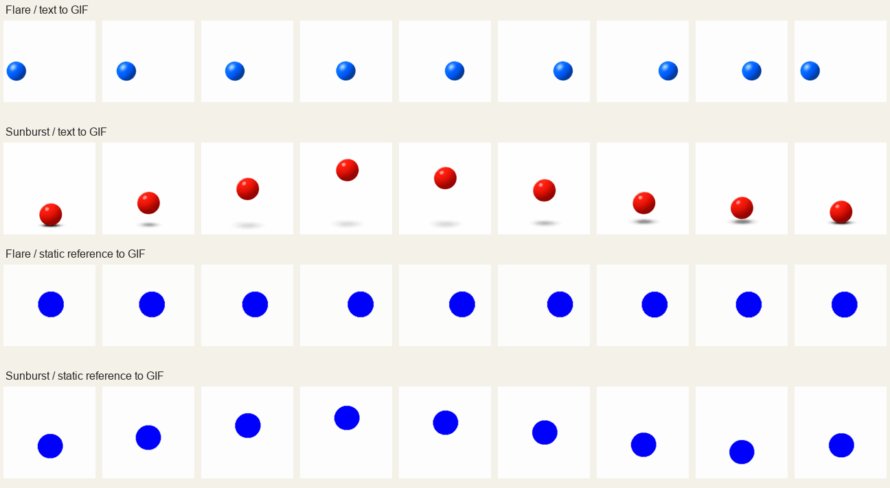

# v0.17.0 网页 GIF 真实验收

日期：2026-11-12，Asia/Shanghai。通过已有 SSH MCP（服务器连接工具）连接 Debian 服务器，在隔离目录运行候选源码，复用容器已有 `oauth_login` / Free 网页账号。四项验收均返回 HTTP 200，每项仅提交一次，完整 GIF 原字节已取回并校验哈希。

源码基于 `249b47117b9f851f8a3f01c03dec9ba26e15d6a0` 的 v0.17.0 工作树快照，压缩包 SHA256 为 `be0defbe9109e17afaa234ac31b2a3a831b19eaf53486e9d04993728f318367b`。该快照包含 GIF 生成、选择与保存路径；之后的审查补丁加强输入拒绝及轮询配置一致性。此记录是冻结源码实测证据，不将工作树快照冒充发布提交。

## 结果

| 场景 | 请求型号 | 耗时 | GIF 尺寸 | 实际帧数 | 不同解码帧 |
| --- | --- | --- | --- | --- | --- |
| 文生 GIF | Flare | 61.50 秒 | 438 × 388 | 9 | 9 |
| 文生 GIF | Sunburst | 60.91 秒 | 412 × 412 | 9 | 9 |
| 静态参考图动画化 | Flare | 90.69 秒 | 445 × 395 | 9 | 9 |
| 静态参考图动画化 | Sunburst | 77.64 秒 | 419 × 419 | 9 | 9 |

四份文件均为 `image/gif`，所有帧完整解码，每帧 200 毫秒，总播放时长 1.8 秒，无限循环。可观察到逐帧变化，运动幅度随上游生成而异；不能据此保证提示中的动作效果、尺寸或帧数完全一致。

原动画：[Flare 文生](evidence/image26-gif-v0.17.0/flare-generation.gif)、[Sunburst 文生](evidence/image26-gif-v0.17.0/sunburst-generation.gif)、[Flare 静态参考图](evidence/image26-gif-v0.17.0/flare-static-reference.gif)、[Sunburst 静态参考图](evidence/image26-gif-v0.17.0/sunburst-static-reference.gif)。[机器可读脱敏报告](evidence/image26-gif-v0.17.0/acceptance.json)记录请求型号、提交次数、全部媒体信息及 SHA256。



## 发现与修正

第一轮 Flare 文生和两种模型的静态参考图动画化已下载到 GIF + PNG 预览，但逐份严格校验把伴随 PNG 也当成必需动画，导致 HTTP 502；该轮 Sunburst 文生仅返回 PNG，确实不满足 GIF 目标。

修改后的选择逻辑只保留可完整解码的多帧 GIF，过滤静态伴随预览；没有合格动画则明确失败。已补 GIF/PNG 两种顺序的公开接口回归。第二轮四项均成功，其成功次数与第一轮失败请求分别记录，未将单次失败后的再次验收包装成自动重试。

准备与提交请求的具体网页型号已经核对，参考图上传路径也已核对。会话请求型号与独立底层图片引擎身份是不同证据，本次未独立认证底层引擎。

## 本地验证与审查

- 232 项后端隔离回归通过，覆盖公开生成/编辑、Chat 普通及流式、Responses 参数、后台任务与跨重启恢复、GIF 原字节保存、PNG/单帧/损坏/SVG 拒绝、混合预览及动画输入。其中 GIF 专项为 16 项，全部测试无失败、错误或跳过。
- 11 项前端测试通过，使用公开 HTTP 请求和历史保存/读取验证格式、帧提示与动画元信息，另覆盖模型切换及 MIME（媒体类型）和下载后缀。
- 生产构建和独立 TypeScript 类型检查通过。浏览器使用真实构建页面、普通用户身份和已实测的 GIF，在本机 HTTP 边界替身上验收交互；该浏览器检查不计为新的真实上游生成。
- 浏览器可见动画持续运动，预览与下载均保留 67,021 字节的原 GIF，SHA256 与服务器原件一致。刷新没有新增提交，复用及重新生成各新增一次 GIF 请求；关闭开关后格式控件禁用，复用的 GIF 请求明确拒绝且没有提交。[浏览器验收记录](evidence/image26-gif-v0.17.0/browser-validation.json)保存这些检查结果。
- 规范审查发现的重复解码与损坏 GIF 首帧绕过、需求审查发现的动画遮罩首帧丢失均已修正，并有修改前失败、修改后通过的公开接口回归。普通及两处补充轮询统一遵守 GIF 等待配置；最终规范和需求复查均无剩余发现。

最终验证命令：

```powershell
& '.\.venv\Scripts\python.exe' scripts\run_offline_tests.py
bun test test
bunx tsc --noEmit -p web/tsconfig.json
# 在 web 目录执行
bun run build
```

验收只复制临时 access token（访问令牌），不复制或刷新 refresh token（刷新令牌）。生产服务没有重启或覆盖；本任务两个隔离目录的临时凭据、日志、scratch 及依赖缓存均已清理，保留脱敏报告和图片。[清理核对记录](evidence/image26-gif-v0.17.0/server-cleanup.json)确认原容器仍为 v0.16.5 且未重启。本机浏览器验收服务也已停止，公开报告不包含账号凭据、邮箱、SSH 地址或签名下载链接。

当前能力和接口示例见 [GIF 接入说明](../image26-gif-guide.zh-CN.md)，上游/fork 依据见 [实施前调研](image26-free-web-gif-2026-11-12.zh-CN.md)。
